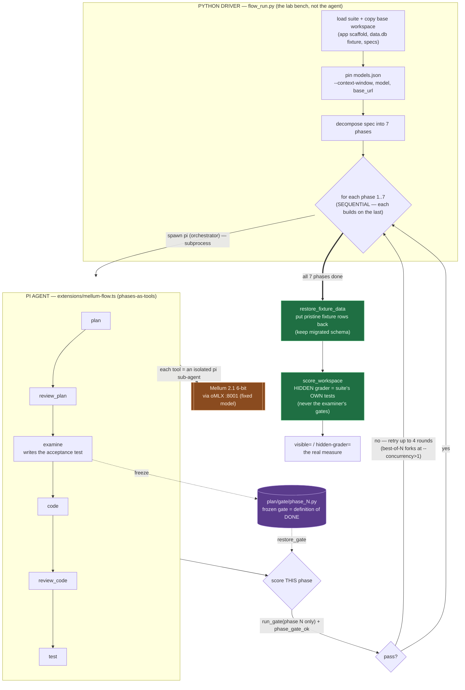

# Flow harness — architecture map

How the spec-driven flow drives the FIXED model (Mellum 2.1, 6-bit via oMLX)
through a suite, and where the harness guarantees sit. The agent lives in Pi
(TypeScript); the Python layer wraps it with the orchestration and grading that
don't depend on the model behaving.

## How to read it

- **Python driver (`flow_run.py`)** sets the task, pins the model profile, splits
  the spec into 7 phases, and loops them **sequentially** (phase 6 builds on 5).
- **Pi agent (`extensions/mellum-flow.ts`)** runs the phase as tools —
  `plan → review_plan → examine → code → review_code → test` — each an isolated
  `pi` sub-agent calling the fixed model. `examine` **freezes** the acceptance
  gate; `code` must make it pass.
- **Per-phase scoring:** `run_gate(phase N only)` + `phase_gate_ok` — a phase
  passes on **its own** gate, so a stochastically-brittle earlier gate can't
  cascade into later phases. Retry up to 4 rounds; best-of-N forks when
  `--concurrency > 1`.
- **Final grade:** `restore_fixture_data` restores the pristine fixture rows
  (keeping the coder's migrated schema), then `score_workspace` runs the suite's
  **hidden** grader — never the examiner's gates. That is the real measure.

## The load-bearing idea

The model builds the app; the harness only wraps it. The durable wins are the
Python-side **guarantees** — per-phase scoring (don't block a correct build),
fixture restore (don't corrupt the data it's graded on), schema injection (prime
it with the real columns), best-of-N (more tries) — none of which write code.
The remaining gap on the database phases is the model's build quality, which the
harness can raise the odds on but cannot manufacture.
