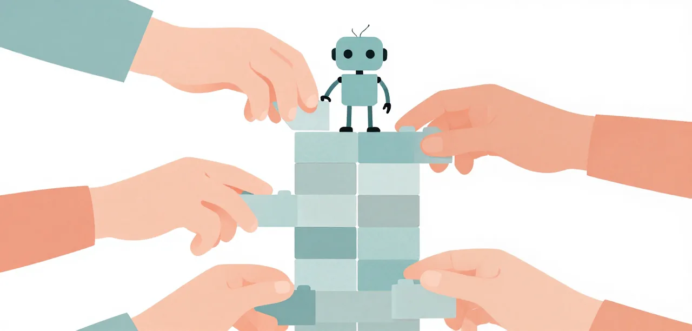

# Contributing a Lesson

If you have an idea for a lesson, follow this process:

1. **Write it as a digest first.** Put the idea in `docs/superpowers/research/` in the six-step form (Problem → Eval case → Evidence of the problem → Solution → Validation → Interpretation), with a badge on each of steps 1–5.
2. **Review every claim against its linked record.** Each step must cite a source: a ladder record, a research note, a commit message, or reasoning. No claim goes in without a link.
3. **Copy the lesson template.** Use [`../lesson-template.md`](../lesson-template.md) as your starting point.
4. **Write the Interpretation within its weakest badge.** If the weakest badge is `screen`, say so; don't state conclusions as if they were proven.

{ .illustration }

## Consent rule

No lesson attributed to someone is published without their written yes. A PR comment or issue is enough; it is linked from the phase's Status cell in the roadmap. This applies especially to lessons about Andre's work.

## How to write an Interpretation

- Name the weakest badge among steps 1–5 that your conclusion relies on.
- State nothing stronger than that badge supports.
- Say which backend the evidence came from when it differs from the learner's (llama.cpp).
- End with what is still open: the run that would upgrade the weakest badge, or the question the evidence cannot answer.
- Do not add new numbers. All data belongs in steps 1–5.
