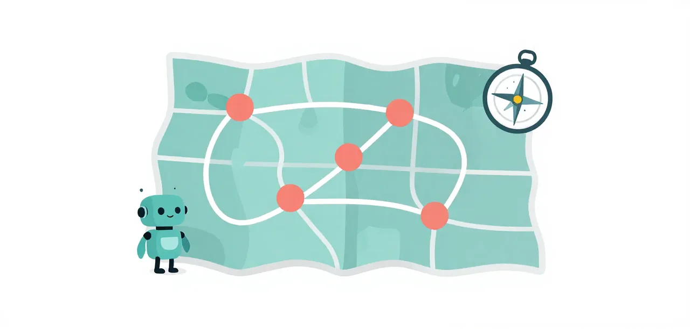

# How to Read a Lesson

The center has two [tracks](../glossary.md). The **Getting started** track is a course in a fixed order; **Lessons** are findings that stand alone: each lists its prerequisites, and you can read them in any order.

{ .illustration }

## Getting started steps

Five steps, done in order, from a clone of this repo:

1. [Base Pi on llama.cpp](../getting-started/base-pi-on-llamacpp.md): a server, a `chat` command, and Pi answering through a private profile.
2. [Working with Pi](../getting-started/working-with-pi.md): starting Pi, its tools and sessions, project trust, and the course's `/lesson` and `/remedy`.
3. [Eval suites and the telemetry](../getting-started/eval-suites.md): three AgentClinic suites, hidden graders, and the trace that explains a failure.
4. [Extensions and Remedy Units](../getting-started/extensions.md): what a Pi extension and a remedy unit are, presets, and `/mellum` as one bundle.
5. [Troubleshoot](../getting-started/troubleshoot.md): the usual causes when a step does not print what it should.

The mini harness is the Getting Started page [The Harness](../getting-started/the-harness.md).

Every command is `uv run` from the repository root. Each page ends with
**What you have**, which is what the next step starts from, so you know a
step worked when its check prints what the page says: a reply, a `PASS`
score line, or the static graders reporting.

## The six steps

Every findings lesson follows the same structure:

1. **Problem**: what a small model does wrong, in one paragraph you can recognize from your own runs.
2. **Eval case**: the rung or task that reproduces the problem, and how it is scored.
3. **Evidence of the problem**: the runs that show the problem, with sample size and backend.
4. **Solution**: the change that was tried, with a link to the commit or file.
5. **Validation**: the before/after evidence table, then the test suite and static analysis that show the change holds, with the command and what it said.
6. **Interpretation**: a short narrative: what the evidence means, how far its badges let you trust it, and what is still open.

Steps 1–5 each carry an [evidence badge](./evidence.md#badges). The Interpretation does not; it is commentary, not evidence.

## What an Interpretation is and is not

- It names the weakest badge among steps 1–5 that its conclusion relies on, and states nothing stronger than that badge supports.
- It says which backend the evidence came from when that differs from yours (llama.cpp).
- It ends with what is still open: the run that would upgrade the weakest badge, or the question the evidence cannot answer.
- It contains no new numbers. All data lives in steps 1–5.

## Worked example

The [PR digest](https://github.com/andrevanzuydam/mellum-worker/blob/main/docs/superpowers/research/2026-10-20-pr-digest.md) walks through idea 1 (the worker decides when it is done) in the six-step form. It is not yet a lesson, but it shows the structure.
