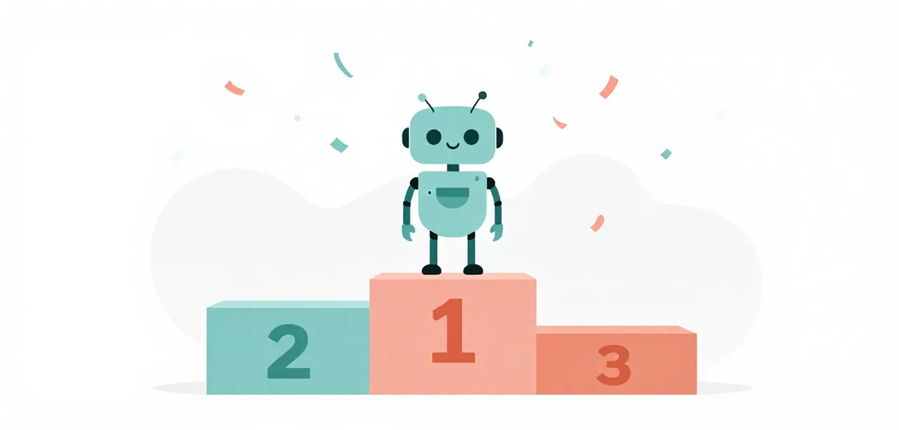

# The Challenge

You have run a small model, built a harness and read what goes wrong. Now
prove it: point your setup at the same three projects every lesson is measured
on, and see how far it gets.

{ .illustration }

## Understanding the Challenge

### AgentClinic — the app

Every level builds the same app, **AgentClinic** — a FastAPI and Jinja2 site,
styled with Bootstrap, where AI agents air their grievances about the humans
they work with. It starts as a near-empty workspace: a `pyproject.toml`, an
`AGENTS.md` of house rules (the test command, and "do not start servers"), and a
`specs/roadmap.md` that lays out the phases in order. No framework scaffolding is
handed over — the model writes `app.py`, the templates and the data model itself,
from the spec.

### How a run is scored

The model is asked to build the app one **phase** at a time, all in a single
session. It may run the project's tests (`uv run --frozen python -m pytest
tests`) but it never sees what it is judged on: when the session ends a hidden
grader runs the checks for **every** phase. So a later phase that breaks an
earlier one fails the whole run, and the only pass is every check green.

The levels are cumulative. Medium is Easy plus three more phases; Hard is Medium
plus three more phases and a real database.

## The three levels

The levels stack. Each adds phases to the one before, and the hidden grader runs
every phase that should exist by then — so the check count climbs as the app
grows.

| Phase the model builds | Easy | Medium | Hard |
| --- | :---: | :---: | :---: |
| 1 · Home page + shared layout | ● | ● | ● |
| 2 · Complaints board | | ● | ● |
| 3 · Add a complaint | | ● | ● |
| 4 · Resolve & reopen | | ● | ● |
| 5 · Archive & audit | | | ● |
| 6 · Database report (SQLite) | | | ● |
| 7 · Visits report | | | ● |
| 8 · Schema migrations | | | ● |
| **Hidden checks** | **4** | **18** | **34** |

Each level has its own page — what to build, the trap to clear and the checks:
**[Easy](easy.md)** (4 checks) · **[Medium](medium.md)** (18) ·
**[Hard](hard.md)** (34). No setup measured here has passed Hard yet.

## The score to beat

The suite baseline is the reference: Vanilla Pi, three sessions per
level on llama.cpp (the [Lessons](../lessons/index.md) show what it gets
wrong), with the same Mellum model you set up in
[Getting Started](../getting-started/index.md). The last row is the replicable
baseline: the same model at full precision on a rented GPU, rebuilt with
`scripts/baseline/baseline.py`.

| Setup | Easy | Medium | Hard |
| --- | --- | --- | --- |
| Vanilla Pi | 0/3 | 0/3 | 0/3 |
| The Baseline Worker | 1/3 | 2/3 | 0/3 |
| Vanilla Pi, BF16 on vLLM (the replicable baseline) | 1/3 | 1/3 | 0/3 |

These are the figures as last measured here; the full run-by-run record is the
[Scoreboard](../scoreboard.md), and the findings lessons' own numbers are being
re-measured, so a page can lag during the rebuild.

A pass means every hidden check passed. Anything less is a fail, and the
record tells you which checks were missing and why.

## Attempt it

You need the [Getting Started](../getting-started/index.md) setup: a local
model, Pi, and the suites. You do not need the lessons; they are a reference
for when a run fails in a way you do not understand.

From a trusted checkout, run a level in Pi with `/challenge`. It runs on the
**thin worker** (Mellum mode on, nothing bundled); switch extra remedy units on top with `/remedy` (see
[Remedies you can try](remedies.md)), then run the tier:

```
/challenge easy
/remedy on tool/bounded-commands
/challenge easy
```

The first line runs Easy on the thin worker with nothing extra — your
baseline. The next two switch on one unit and run it again, so you can watch the
score move. (`/remedy preset:easy` switches on Easy's measured stack, which R.1
left empty: no unit beat Vanilla Pi within budget.) For Vanilla Pi with no worker extension, add `:vanilla`
(`/challenge easy:vanilla`). `/challenge easy n=3` runs three times; `/challenge
submit` opens a pull request with the runs you pick. While it runs, the model's
turns stream so you see what it is doing, and the result reports the passes, the
turns and the wall-clock. See [Working With
Pi](../getting-started/working-with-pi.md#challenge-score-a-tier-on-the-thin-worker-with-the-remedies-you-have-on).

Change one thing at a time, run the same level again, and compare — that is
exactly how every [lesson](../lessons/index.md) is built.

**From the command line**, the same runs go through the harness directly:

```bash
uv run python learn/code/harness.py run --suite easy --repeat 3 --grade
uv run python learn/code/harness.py run --suite medium --remedy preset:medium --repeat 3 --grade
uv run python learn/code/harness.py run --suite hard --remedy preset:hard --extension path/to/yours.ts --repeat 3 --grade
```

`--suite` picks the tier, `--remedy` takes units or a preset, and `--repeat`
the count. Hard's orchestration (plan, examine, code, frozen gates) runs through
`learn/code/flow_run.py --suite hard`.

## Tips

- Start with Easy. If it does not pass, the problem is in the setup, not the
  model's ambition; [Troubleshooting](../getting-started/troubleshoot.md)
  covers the usual causes.
- Read the trace, not only the score: [Pathologies](../pathologies.md) names
  the ways a small model goes wrong, and most failed sessions show one of
  them.
- Compare like with like: the same level, the same number of sessions, one
  change at a time.
