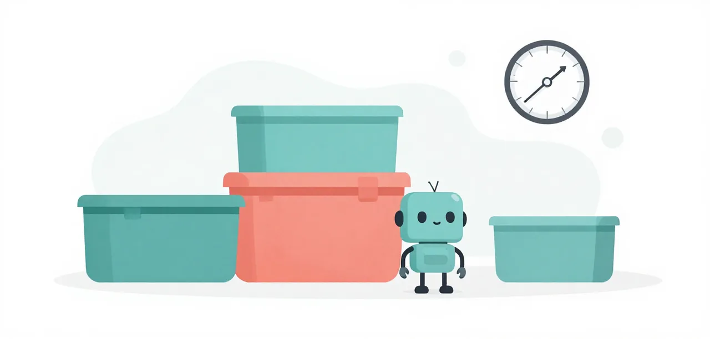

# Eval Suites and the Telemetry

This step runs **eval suites**: whole projects the model has to build, with a
mission, a tech stack, a roadmap, a sequence of prompts, and a hidden grader.
You run them through the provided harness, `learn/code/harness.py`, read the
score, and read the trace to see why. Each session runs Pi in a fresh
directory, isolated from your own settings. The next step,
[The Harness](the-harness.md), shows how one is
written.

{ .illustration }

## What an eval suite is

A suite is a directory under `learn/code/suites/`:

```text
easy/
  base/            the project the session starts from
    specs/mission.md      what the app is for, and what it is not
    specs/tech-stack.md   languages, libraries, database, conventions
    specs/roadmap.md      the phases, or the requests, in order
    AGENTS.md             the ## Mellum facts: test command, write list
  prompts/         one file per request, sent in order
  grader/          the hidden tests, copied in only after the session
  expected.json    the test IDs the grader must report as PASSED
  fixtures/        known-good and known-broken, for qualification
  grader/canary    a marker that tells you the model touched the grader
```

The base is the **constitution**: mission, tech stack and roadmap. The prompts
do not repeat those rules; a model that never reads the project's documents
fails because of that, not because the harness withheld something.

## The three suites

The three suites are Bronze, Silver and Gold, and together they are [The Challenge](../challenge/index.md).

| Suite      | Starts from                                                           | Requests                              | Graded on                                  |
|------------|-----------------------------------------------------------------------|---------------------------------------|--------------------------------------------|
| **Bronze** | an empty AgentClinic project, with a hinted four-phase roadmap        | one: phase 1                          | the phase-1 grader                         |
| **Silver** | an empty AgentClinic project, with a user-story roadmap               | four: one per phase                   | phases 1–4                                 |
| **Gold**   | an empty AgentClinic project, with a user-story roadmap and `data.db` | eleven: seven phases, four migrations | phases 1–7, the reports and the migrations |

Gold is the one that punishes assumptions: the same four phases as
Silver, then three more, with four migrations interleaved. The database schema
has to be discovered, and `archived_at IS NOT NULL` is not the same as
`status = 'archived'`.

### What Gold adds

The first four requests are Silver's. The rest are:

| Request | What it asks for                                                                                                                                                                                                                                                        |
|---------|-------------------------------------------------------------------------------------------------------------------------------------------------------------------------------------------------------------------------------------------------------------------------|
| phase 5 | Archive only resolved complaints (open is a 400), hide them from the board but keep the rows, record every transition in `models.audit`, and return open counts from `/stats`.                                                                                          |
| phase 6 | A `/report` over the `tickets` table: open, archived and all-time cents as integers. Archived means `archived_at IS NOT NULL`; every value is a bound parameter.                                                                                                        |
| phase 7 | `/visits`: filter `visits` by an inclusive `from`/`to` range and `min_minutes`, group by agent, and return count, total minutes and average minutes. Sort by total descending, then agent name, and apply `limit`. Counts and totals are integers; averages are floats. |

The migrations run against `data.db` between phases: the
`tickets(status, archived_at)` index, a backfilled `resolved_at`, an
`open_tickets` view, and a `note` column. They are ad-hoc requests, not
phases: no later prompt is visible until it is sent. Each is a function in
`migrations.py` in the `agentclinic` set, applied with
`sqlite-utils migrate data.db`; sqlite-utils records it in
`_sqlite_migrations`, so re-running is a no-op.

Complaints stay in memory; the database holds `tickets` and `visits`. That
keeps phases 1–4 unchanged while still making the worker discover a schema,
write migrations and test database behaviour.

## Run and qualify

```bash
uv run scripts/backend.py start
uv run learn/code/harness.py run --suite all --grade
```

One line per suite (`easy` is Bronze, `medium` Silver, `hard` Gold), then a total:

```text
easy: PASS (n=1; run /var/folders/...; 1 request, 3 tool calls, 0 tool errors)
medium: PASS (n=1; run /var/folders/...; 4 requests, 7 tool calls, 1 tool error)
hard: FAIL (n=1; run /var/folders/...; 11 requests, 10 tool calls, 2 tool errors)
2/3 suites passed
```

A `FAIL` does not stop the run; the session stays on disk and its test tail is
printed to stderr. `--repeat 2` runs a suite twice and states its n.

Before trusting a suite, prove its grader in both directions:

```bash
uv run learn/code/harness.py qualify --suite hard
known-good: PASS
known-broken: FAIL
hard: QUALIFIED
```

`known-good` is a reference solution; `known-broken` is the same project with
one thing wrong. A grader that cannot tell them apart is not a grader.

## How a session is graded

1. The prompts are sent, in order, in one isolated session.
2. The child exits; only then are the hidden graders copied into the run.
3. pytest runs them. Every test ID in `expected.json` must appear as `PASSED`;
   a missing test is a finding, not a silent pass.
4. `--grade` adds static analysis on the model's files, before the tests are
   copied in:
   - **`ruff`**: correctness rules `F,E9` (undefined names, unused imports);
     a finding fails the session.
   - **`complexipy`**: cognitive complexity above 10; a finding fails the
     session.
   - **`pyrefly`**: types, advisory. It reports, it does not fail the session.
5. The line prints the verdict and the counts; the grader lines print beside
   it. The run's `run.json` also names the expected tests that did not pass and
   groups them by grader module, so a session that fails four of six checks
   says which module those four came from. A grader that cannot run at all (
   a collection error, a module the workspace never created) records
   `checks_ran: false` beside the count, because "the checks failed" and "the
   checks never ran" are different findings. It is still a failure: nothing
   passed.

A failure is a finding about the code, not necessarily about the tests: a
project can pass its hidden tests and still carry an unused import, a type
lie, or a function too tangled to read.

## Isolation and the canary

Runs live under the system temp directory, not inside the repo. The Pi
profile and the recorder are copied into the run, so nothing in the child's
argv or environment points back at the suite. The hidden grader is not in the
workspace while the child is running.

A canary in `grader/` is the tripwire. The trace is scanned after the run; if
the model read the canary or walked into `learn/code/suites/`, the session is
`CONTAMINATED`, never a pass. That is detection, not confinement: it tells you
the result cannot be trusted.

## Read the trace

Every run writes `trace.jsonl` beside its workspace. The rows to read first:

- `provider_request`: one turn sent to the model;
- `tool_call` and `tool_result`: what it reached for, and whether the call
  errored;
- `message_end`: a message, including the final reply's text;
- `agent_settled`: the run ended.

A Gold run that fails with 11 requests and 2 tool errors kept going and kept
hitting errors; a run that fails with 1 request and no tool calls wrote
nothing. The counts on the score line are these rows, summed.

## One session is not a rate

A suite is a handful of sessions, and each session is one observation. The
same project can pass next time: the model varies, and this harness runs a
suite once by default. Run it again before believing a difference, and still
treat two or three sessions as a lead, not a rate. Rates come from a
preregistered run on these suites, with the arms and n fixed before it starts,
which is why findings lessons cite a record in `docs/superpowers/research/` and
not one session.

## What this does and does not say

These suites are a teaching harness: one machine, one model, one session per
suite. They show you *where* to look (a tool error, a missing file, a final
reply that claims success, a test that was never collected), not how often a
model fails. A single session shows you where to look; a preregistered
reference run on llama.cpp, recorded in `docs/superpowers/research/`, is what
findings lessons cite.
