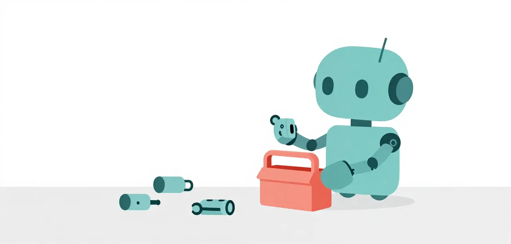

# Extensions and Remedy Units

A Pi extension is a TypeScript module that exports a default factory. Pi calls
that factory with an `ExtensionAPI`; the extension registers commands, tools,
or event handlers. It runs inside the Pi process with the same permissions, so
load only extensions you trust.

Every fix in this course is a small extension called a remedy unit. This step
is about the mechanism: the hooks a unit uses, how units are grouped into
presets, and the two ways to switch them on. What each unit buys is measured
in the Lessons.

{ .illustration }

## A minimal extension

```ts
import type { ExtensionAPI } from "@earendil-works/pi-coding-agent";

export default function (pi: ExtensionAPI) {
  pi.registerCommand("hello", {
    description: "Show a greeting",
    handler: async (name, ctx) => {
      ctx.ui.notify(`Hello, ${name || "world"}!`, "info");
    },
  });

  pi.on("tool_call", (event) => {
    if (event.toolName === "bash" && String(event.input.command).includes("rm -rf")) {
      return { block: true, reason: "Refusing a recursive delete." };
    }
  });
}
```

`registerCommand` adds a `/hello` command. `pi.on` registers a **callback** for
a named **event**. Some callbacks only observe; others transform data, block a
call, or ask Pi for one more model request. The return value is part of the
contract, not decoration.

## The hooks the units use

| Hook | When it runs | What a unit does with it |
| --- | --- | --- |
| `tool_call` | Before each tool call | A guard returns `{ block: true, reason }` to stop the call; the reason goes back to the model. |
| `before_provider_request` | Before each request to the model | Rewrites the request: replaces the system prompt, adds project facts, narrows the tool list. |
| `agent_before_settle` | When the run is about to end | Asks for one more turn, as the empty-turn nudge does. |
| `registerTool` | Once, when the unit loads | Adds a tool the model can call, such as the library-docs lookup. |

Pi runs handlers in registration order and awaits them. A handler may be
async; an error in a `tool_call` handler blocks the tool as a fail-safe,
while an ordinary event error is reported and Pi continues.

## A remedy unit

A remedy unit is one remedy in one file under `remedies/<kind>/`, where the
kind is `guard`, `nudge`, `context`, `prompt`, `tool`, `check`, `delegate` or
`workflow`. It has one
role: it installs one behaviour on Pi's hooks and nothing else. It also
exports a `meta` record (the pathology it fixes, what it does, its lesson and
its evidence); the remedies table in [The Challenge](../challenge/index.md)
is generated from those records.

The smallest is a guard. This is `remedies/guard/repeat-loops.ts`,
whole:

```ts
/** Remedy unit: block the same tool call repeated with nothing changed in between. */
import { createLoopBreaker } from "../../extensions/mellum-guards.ts";
import { installGuard, type PiLike, type UnitMeta } from "../install.ts";

export const meta: UnitMeta = {
	pathology: "Repeats the same call with nothing changed",
	does: "Blocks a call made 5 times in a row unchanged",
	lesson: "E3",
	evidence: "ladder: part of the guard set behind phase 2b's 15/15",
};

export function install(pi: PiLike, opts: { window?: number; threshold?: number } = {}): void {
	installGuard(pi, createLoopBreaker(opts.window, opts.threshold));
}

export default (pi: PiLike) => install(pi);
```

`installGuard`, in `remedies/install.ts`, is the shared wiring: a guard is a
function from a tool call to a decision, attached to `tool_call`.

```ts
export function installGuard(pi: PiLike, guard: Guard): void {
	pi.on("tool_call", (event) => guard({ toolName: event.toolName, input: event.input }));
}
```

The other kinds follow the same shape on a different hook. A unit that adds a
tool (the `tool`, `check` and `workflow` kinds) loads an existing extension
through `keepingTools` in `install.ts`, so `context/narrow-tools` keeps the
tools it registers instead of dropping them.

## Presets

A preset is a named list of units in `remedies/presets/<name>.json`.

| Preset | Units | What it is |
| --- | --- | --- |
| `easy` | 4 | Three prompt fragments — name the layout, the Python-developer frame, verify the whole spec — and the foreground-server guard |
| `medium` | 4 | The same four units as `easy` today |
| `hard` | 4 | The same four units as `easy` today |
| `baseline-worker` | 5 | The worker's own set: narrow tools, the empty-turn nudge, and three guards (repeat loops, outside the workspace, foreground servers) |

## Two ways to apply them

**On a harness run.** `--remedy` takes unit names, a preset, or both,
separated by commas; `--extension` loads an extension of your own, and can be
repeated. An unknown name is refused before anything runs.

```bash
uv run python learn/code/harness.py run --suite easy --remedy guard/repeat-loops
uv run python learn/code/harness.py run --suite easy --remedy preset:easy,nudge/empty-turn
uv run python learn/code/harness.py run --suite easy --extension path/to/yours.ts
```

**In a live Pi.** In a trusted checkout, `/remedy` switches units and presets
on and off in the running session, as
[Working With Pi](working-with-pi.md#remedy-switch-remedy-units-on-and-off)
shows. Use it to watch a unit act; use `--remedy` when you want a score.

## The worker is a command tool, not a bundle

The Mellum worker, `extensions/mellum-worker.ts`, is only the `/mellum` command
and the mode machinery. It switches the model to Mellum for a span, drops the
pre-marker history so Mellum never sees the parent's turns, counts the span and
writes the run record — and swaps **nothing** into the request: not the prompt,
not the tools, no project facts, no guards. The prompt, the narrowed tool set
and every guard are remedy units you add explicitly; `baseline-worker` above is
the set that equals the old bundle, inspectable like any other preset.

| Lever | Hook or event | What the callback does |
| --- | --- | --- |
| Command | `registerCommand("mellum")` | One-shot `/mellum <task>`, or `/mellum on` / `off`. |
| History | `before_provider_request` | Keeps the system prompt and tools; drops the pre-marker turns (mode-integrity), so Mellum sees only the span. |
| Span | `tool_call`, `turn_end` | Counts calls and output tokens for the `/mellum off` summary and the run record — it does not block. |
| Context | `context` | Collapses the worker span into one handoff block for the parent. |
| Restore | `agent_settled` | Notification-only boundary: the span has ended, so the extension restores the previous model and tools. |

The same session runs the worker and then returns to the main model with a
handoff. The wrapper sets the profile, session, model, isolation flags and
extension. This is a smoke, not evidence:

```bash
learn/code/clinic "/mellum Reply with the single word: ready."
```

## Prompts, tools and guards are mechanisms

Those are three separate levers, and each is a remedy unit — the worker pulls
none of them:

- the **prompt** is text the extension installs;
- the **tool set** is the list Pi exposes to the model;
- the **guards** are functions that inspect a call or a turn and decide whether
  to block or continue.

Pi offers `read`, `bash`, `edit` and `write` by default. `context/narrow-tools`
keeps seven (`read`, `grep`, `find`, `ls`, `bash`, `edit`, `write`) plus the
tools your units register, and drops the rest; it matters when another
extension or an MCP server has added tools. It is not measured on its own.

## Stay in the workspace

A model can hang a whole run by searching the machine instead of its
workspace: `grep -rl pattern /Users /var /tmp …` crawls everything and keeps
the tool call open. The runaway search guard is now the
`guard/outside-workspace` unit, part of `baseline-worker`: it
blocks a recursive search that names a path outside the workspace. It covers
searches only; a write by absolute path is not covered yet.

## What you have

What a Pi extension is and the four hooks the units use, what one remedy unit
looks like, the presets, and two ways to switch units on: `--remedy` and
`--extension` on a harness run, and `/remedy` in a live Pi. Next, take the
[Lessons](../lessons/index.md) or go straight to
[The Challenge](../challenge/index.md).
