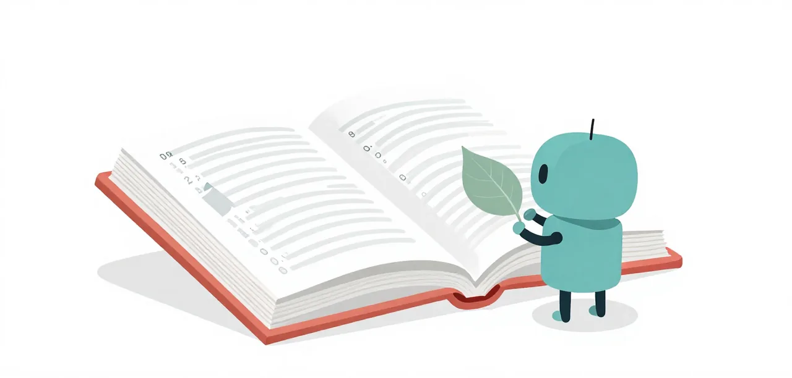

# Glossary

Terms are linked on their first occurrence in each page by
[`zensical-glossary`](https://pypi.org/project/zensical-glossary/). The source
of truth is this page; do not hand-link a term in prose.

{ .illustration }

## The course

### Learning Center

The whole Zensical site under `learn/`.

### Track

A group of lessons with a recommended order: Getting started and Lessons.

### Lesson

One page that teaches one thing. Getting started steps build on each other;
a findings lesson stands alone and lists its prerequisites.

### Six-step template

Problem → Eval case → Evidence of the problem → Solution → Validation →
Interpretation. Every findings lesson uses it.

### Interpretation

The closing narrative of a lesson: what the evidence means, how far its
badges let you trust it, and what is still open.

### Challenge

<!-- zensical-glossary-aliases: The Challenge, Bronze, Silver, Gold -->
The three levels learners attempt to test what they have learnt: Bronze (one
prompt, 4 hidden checks), Silver (four prompts, 18 checks) and Gold (eleven
prompts, 34 checks). They are the eval suites `easy`, `medium` and `hard`;
[The Challenge](challenge/index.md) explains how to attempt them.

### Phase

The container a set of feature cycles runs in: the Learning Center (`LC`), and
historically the `M` series. A phase has no plan of its own. Not the same as a
suite phase, which is one step of a multi-phase eval task such as the hard
suite's seven.

### Feature cycle

One roadmap row inside a phase, named `LC.13A`. It runs the SDD cycle (
brainstorm, spec, plan, execute, review/close) and delivers one lesson, or,
when its Ships cell says so, housekeeping or infrastructure. "Phase" was the
older name for a row and means the same thing wherever it survives in a
record.

## Evidence and badges

### Badge

A label on each of steps 1–5 saying what the step rests on: `reference-run`,
`cited`, `screen`, or `conjecture`.

### Screen

A badge for a few targeted runs, or one observation, that is not a rate. A
screen can show that a problem exists; it cannot establish a remedy’s effect.

### Cited

A badge for an existing oMLX or mlx-lm record in `evals/` or a research
note. It is stronger than a screen and weaker than a `reference-run`.

### Reference-run

A preregistered run on llama.cpp, made for a lesson, on the suites the course
teaches. Earned with a preregistration written before the run, the record in
`docs/superpowers/research/`, and raw evidence in a `research-*` release.

### Conjecture

A badge for no run: reasoning, design or unit tests only.

### Pathology

A way a small model has been observed to fail on an agentic task, recorded with
the run that shows it and the shape that answers it. [The Pathologies
page](pathologies.md) keeps the list; an entry without an observation behind it
is a hypothesis, not a pathology.

## Experiments and arms

### Baseline lesson

Until 2026-10-29, the n=3 comparison of Baseline Pi and the Baseline Worker on
easy, medium and hard. S0 Start Here now teaches reading
Baseline Pi's failures and naming what went wrong; the worker is a preset, not a lesson.

### Baseline Worker

<!-- zensical-glossary-aliases: full worker -->
The shipped `/mellum` worker: worker prompt, seven built-in tools,
empty-final nudge, loop breaker, project facts, context isolation and the
handoff. It is the control for a remedy lesson.

### Baseline Pi

<!-- zensical-glossary-aliases: bare Pi -->
Pi with no worker extension: Pi’s base system prompt, the built-in tools and
no worker guards or facts.

### Arm

One configuration in an experiment. The suite arms are `bare`, `worker`,
`no-prompt`, `no-nudge` and `no-loop`.

### Ablation

A comparison that removes one part from the Baseline Worker. An ablation
measures the removed part; it is not a lesson module.

### Remedy

A change that corrects one pathology. Since 2026-10-29 each remedy is a
remedy unit, taught by one lesson, and the worker is the preset of the units
it uses.

### Remedy unit

One remedy in one file under `remedies/<kind>/`: a guard, a nudge, a context
change, a check or one of our tools. It installs one behaviour on Pi's hooks
and nothing else, and exports a `meta` record (the pathology, what it does,
its lesson, its evidence) that the remedies list is generated from. Load it
with `--remedy <kind>/<name>`.

### Preset

A named list of remedy units, loaded with `--remedy preset:<name>`.
`preset:easy` and `preset:medium` are what each tier adds; each tier's
lessons start from the previous tier's preset. `preset:baseline-worker` is
the worker's own list, proven to send the same request as the worker.

### Before and after

The two states every lesson shows of one command. Before is everything the
tier has added up to this lesson, written as one `--remedy` line; after adds
this lesson's one unit.

### Lesson check

A lesson's test: its own small challenge fails with the before line and passes
with the after line, at a preregistered n. A passing check also confirms the
pathology on the host it ran on.

### Tool

A capability the model can call. Pi ships `read`, `write`, `edit`, `bash`,
`ls`, `find` and `grep`; our tool units add `lookup` and others. A remedy
changes behaviour; a tool adds a capability.

### Nudge

A message the worker sends after a turn ends without text or a tool call,
asking the model to continue. The shipped worker allows three per run.

### Empty-final nudge

The specific guard for an empty final turn: `agent_before_settle` sees no
text and no tool call and returns `continue: true` with a restatement of the
completion fact, up to three times.

### No-nudge

The Baseline Worker with the empty-final nudge turned off. It keeps the worker
prompt, seven tools, loop breaker and facts; it is not “no guards.”

### Loop breaker

The guard that blocks the next identical tool call after five repeats with
nothing changed in between. An edit, write or bash call clears the memory.

### No-loop

The Baseline Worker with the loop breaker turned off. It keeps the nudge, prompt,
tools and facts.

### Guard

A function wired to an event that observes a tool call or a turn and decides
whether to block it or ask for one more request. The loop breaker and the
empty-final nudge are guards; they are code, not metadata.

### No-prompt

The Baseline Worker with Pi’s base system prompt instead of the worker prompt.
The tools, guards and facts stay on.

### Strip thinking

Removing earlier assistant reasoning from the payload the worker sends, so the
next request cannot see what the model thought before. Off by default: on this
backend the prefix cache absorbs repeated reasoning, and removing it made runs
60% slower (A12). The worker's `MELLUM_STRIP_THINKING=1` opens the seam so the
claim can be measured, and the harness arm is `--arm strip-thinking`.

### Spec variant

An alternative layout of a suite's project and the prompts that go with it,
selected with `--specs` and recorded in the run as `specs`. It changes how the
same requirements are laid out (one joined `specs/roadmap.md` against one file
per phase) so an arm can hold everything else fixed.

### Greedy

Decoding with `temperature 0`, `top_p 1`, `top_k 0` and a fixed seed. The
llama.cpp reference run used greedy; the suite baseline used sampled values.

### Sampled

Decoding with a temperature above zero. The suite runs use
`temperature 1.0`, `top_p 0.95`, `top_k 20`, the values in the private Pi
profile.

## Suites and measurement

### Mini harness

The small eval harness learners build in Getting started step 3, kept in
`learn/code/`. It is not the ladder.

### Eval suite

A project under `learn/code/suites/`: a base project, the constitution
(mission, tech stack, roadmap, `AGENTS.md`), ordered prompts, a hidden grader
and expected test IDs.

### Session

One run of one suite: one workspace, one trace and one score. `--repeat 3`
means three sessions, and every score line states its n.

### Grader

The hidden tests copied into the workspace only after the model has exited.

### Expected IDs

The test IDs that must appear as `PASSED` for a suite to pass. A missing test
is a failed check, not a silent pass.

### Canary

A marker in `grader/` that shows the model touched the grader. A contaminated
session is not a pass.

### Qualification

The check that a suite’s grader separates `known-good` from `known-broken`:
the first must pass and the second must fail.

### Turns

Model requests in a session, counted from the trace’s `provider_request`
rows. The table’s `Turns` is their mean over n.

### Failed checks

Expected test IDs that did not appear as `PASSED` in the grader run. They are
not the same as failed sessions. A run records them by name and groups them by
grader module, so a suite whose graders are one file per phase reports which
phase's checks are missing, not only how many.

### Checks did not run

A run whose hidden checks never executed: pytest stopped on a collection error,
usually because the workspace lacks a module the graders import, so every
expected ID counts as missing. The record carries `checks_ran: false` beside the
count, so a table cannot read it as the worker failing every check. The session
still fails; it just says why.

### Wall

Seconds from the run start to the last settled child. It is a suite total;
divide by the number of prompts before comparing suites of different length.

### Output tokens

The sum of the model’s output tokens in a session, from the trace usage.

## Pi and agents

### Pi extension

A TypeScript module exporting a default factory that registers commands,
tools or event handlers inside the Pi process.

### Project trust

Pi's decision on whether to load a folder's own resources: `.pi/extensions`,
project settings, skills and prompts. Pi asks at startup, and `/trust` saves
the decision for later Pi processes. It decides what loads, not what a tool
call can reach; `AGENTS.md` loads either way.

### Hook

A point where an extension can observe or change a run. `pi.on` registers
handlers for these points.

### Event

A named lifecycle occurrence such as `before_provider_request`, `tool_call` or
`agent_before_settle`.

### Callback

A handler registered for an event. Its return value is part of the event’s
contract: it may block a tool, replace a payload or request a continuation.

### Main agent

The model and session holding the plan. In this center’s local lessons it is
also Mellum; that isolates the worker role, not what a large parent gains.

### Parent model

The model that owns the session before `/mellum` runs and receives the
handoff afterward. Also called the main agent.

## AI terms

### Agent

A system that uses a model to choose and carry out actions toward a goal.

### Agent loop

The repeated cycle of observing, deciding, acting, and checking results.

### API

An interface that lets software communicate with a model or another service.

### Completion

The output generated by a model.

### Context

All the information supplied to the model for a response.

### Context window

The maximum amount of information a model can handle in one interaction, measured in tokens.

### Embedding

A numerical representation that captures useful features and relationships in data.

### Eval

Evaluation, or eval: a test used to measure a model’s or agent’s quality, accuracy, or behavior.

### Fine-tuning

Additional training that adjusts a model’s weights for particular tasks, styles, or behaviors.

### Grounding

Connecting a response to specific evidence or data.

### Hallucination

An incorrect or invented output presented as though it were reliable.

### Harness

The software that calls the model, supplies context, executes tools, and manages permissions.

### Inference

Running a trained model to generate an output.

### Latency

The time it takes to receive a response.

### LLM

Large language model: a model trained on large amounts of data to process and generate language.

### Agent memory

Information saved outside the model and retrieved for later use.

### Working memory

The model's own earlier reasoning, replayed in the request, that it uses to
keep a plan across tool calls. Removing it from the history makes the model
re-derive that plan.

### Multimodal

Able to process or generate more than one type of content, such as text, images, or audio.

### N-gram

A sequence of *n* neighboring items, usually words or tokens.

### Weights

Also called parameters: the learned numbers inside a model that shape its outputs.

### Pretraining

The initial broad training that builds a model’s general capabilities.

### Prompt

The input given to a model, including questions, instructions, or examples.

### RAG

Retrieval-augmented generation: retrieving relevant information and adding it to the model’s context before it answers.

### System instructions

Instructions that define the model’s role, boundaries, and behavior.

### Temperature

A setting that influences randomness when selecting output tokens.

### Token

A piece of text, such as a word, part of a word, or punctuation.

### Token ID

The number assigned to a token in a tokenizer’s vocabulary.

### Tokenizer

The system that converts text into token IDs and back again.

### Tool calling

A model producing a structured request for software to perform an action.

### Training

The process of adjusting a model’s weights using data.

### Vector

A list of numbers used to represent information mathematically.
