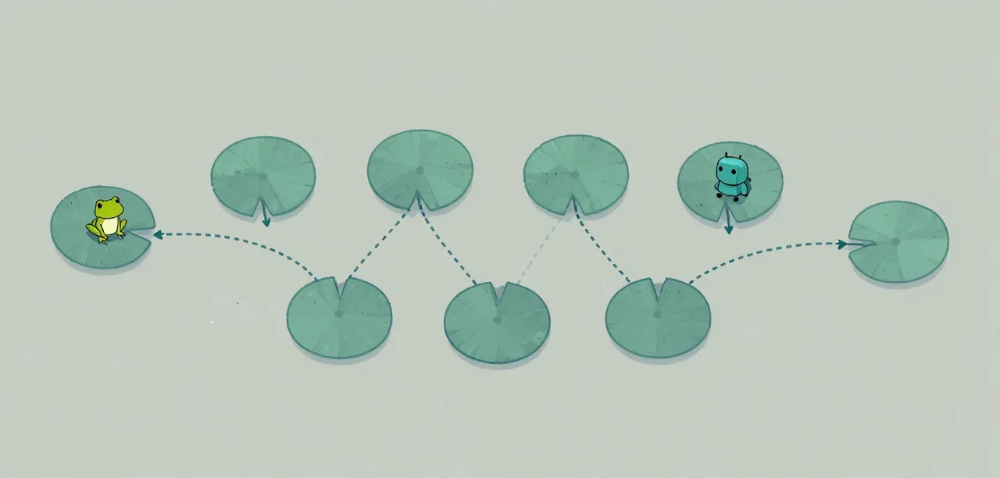

# Introduction

Working with AI can be daunting if you have no concept of what it is and how it is being used, this is our attempt to unbox all the concepts before you begin so your journey begins with the tools to evaluate what you see and understand what is happening. We're on a learning journey as well, so you shouldn't feel intimidated about contributing or asking questions. For those of you who have the knowledge and are reading this, we welcome your input on the science and terminology.
The concepts described below all relate to the teaching material and should be treated as such.

## What is a large language model?

The concept behind a language model goes back to 1913, when Andrey Markov established the mathematical foundation on which every language model is based today.
He proposed a structure (the Markov chain) for what has now developed to become an N-gram in large language models.

Imagine a frog crossing a pond that needs to hop on lily pads from one side of the pond to the other.
The N-gram model has the knowledge of where the frog has been, where it is now and where it can go.

{ .illustration }

The important thing to remember here is that there are a number of possibilities to get from A - Z, and in our coding exercises we are dealing with these probabilities, which can be either positive or negative when it comes to code and achieving the expected outcome.
Based on the learnings above you should now understand that an LLM can make mistakes.

## What is a prompt?
A prompt is the spark that starts the task. It helps guide the LLM to get the next sequence of words. We would understand it simply as the instructions given to an LLM, although technically this is not true.
It is important to understand that all our "instructions" are converted into tokens, which are numerical representations of words or parts of words that the LLM can "understand".

## What is context?

Context in LLM terminology is the goals, information, conversation and information received from the LLM output. Context guides the outcomes and decisions the agents and harness make.

## What are tools?

Tools are methods or code that the agent or harness can call to actually do things. Examples of tools would be editing files, browsing the internet, reading a database, running code.
It is important to understand that tools can do harmful things if unchecked or ungated.

## What is a harness?

The harness is the overarching structure or loop that co-ordinates all the agents to achieve the goal that it has been given. It should maintain the overall context and the road map to achieve the task.
You may hear people referring to the orchestrator when they talk about the harness.

## What is an agent?

Most people talk about harnesses and agents interchangeably because they are closely linked; however, they have two distinct roles which need to be understood.
An agent is a specific tool that does a specific task. You can have an agent that tests or an agent that codes.
An agent can consist of a one-pass instruction or a series of loops that achieves an outcome. Agents use the LLMs or models to achieve the task that they are given by the harness.
An agent generally won't have the full context of what is to be achieved.

## What is the feedback loop?

A feedback loop is the repeated process. It is the determination of whether the harness should stop or continue by checking the outputs or the results.

