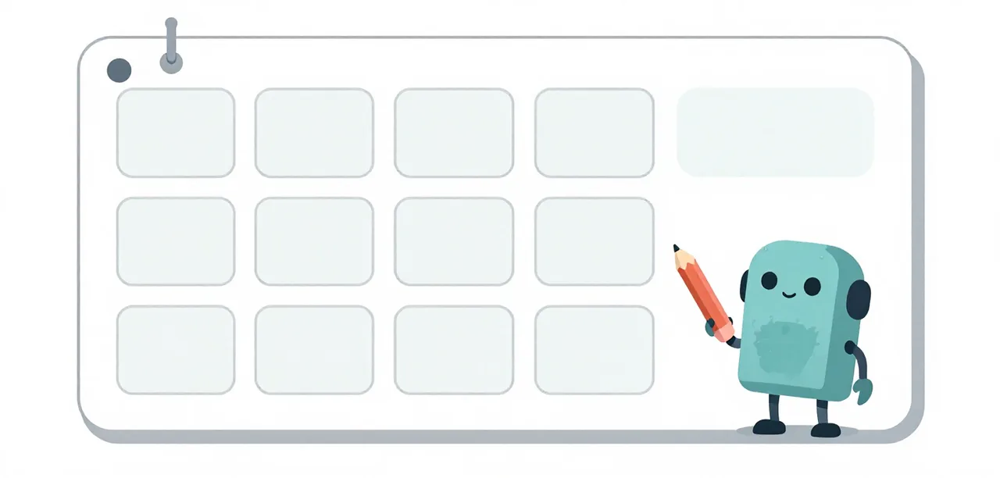

# Lesson Title

The problem in one sentence. The solution in one sentence.

```yaml
---
title: The Worker Decides When It Is Done
tier: medium            # easy | medium | hard (see "Choosing a tier" below)
number: M7              # tier letter + its next free number
time: 6 min read · 45 min to run
track: lessons          # getting-started | lessons
position: 2             # recommended order within the track
prerequisites: [getting-started/harness]
authors: [Andre van Zuydam, Paul Everitt]
backends: [omlx, mlx-lm] # where the badged evidence ran; llama.cpp once re-run
---
```

!!! abstract "Overview"

    **Questions**

    - The question a learner would ask, in their words.

    **Objectives**

    - What the reader can do or recognise after the page, verb first.

{ .illustration }

## Problem

**Badge:** `conjecture` ([badges](about/evidence.md#badges))

Describe what a small model does wrong, in one paragraph a learner can recognize from their own runs.

## Eval case

**Badge:** `conjecture` ([badges](about/evidence.md#badges))

Name the rung or task that reproduces the problem, and how it is scored, with a link to the code.

## Evidence of the problem

**Badge:** `conjecture` ([badges](about/evidence.md#badges))

Show the runs that demonstrate the problem, with sample size and backend.

## Solution

**Badge:** `conjecture` ([badges](about/evidence.md#badges))

Describe the change that was tried, with a link to the commit or file.

### The code

Show the smallest excerpt of the remedy in the page, not only a link: the
prompt lines, the tool list, the guard function or the config that changed.

```ts
// The remedy, reduced to the part a reader needs to see.
```

## Validation

**Badge:** `conjecture` ([badges](about/evidence.md#badges))

### Evidence of the solution

For a lesson that changes a setting, prompt, tool set or guard, show the
before/after arms on the same suites. Compare inside a suite, never across
Bronze/Silver/Gold. **Size the screen by what you read:**

- **A presence claim needs n = 1.** The block reached every request, the guard
  fired, a file was written outside the layout, a session's checks never ran.
  One session settles presence, and it is the cheapest evidence a lesson can
  carry.
- **An absence or a comparison needs n = 3 or more.** "The nudge never fired",
  "no arm separated", "the layout did not change what the worker reached": one
  quiet session is not an absence, and one session per arm is not a comparison.
  At n = 1 the only honest comparative sentence is *"one session each, and X did
  Y"*, which is an observation, not a result.

A `screen` badge is required at either size, and no screen is worded as a rate.

| Suite | Arm | Passes | Turns | Failed checks | Tool errors | Context | Wall | Output tokens | Nudges |
| --- | --- | --- | --- | --- | --- | --- | --- | --- | --- |
| Bronze | before | | | | | | | | |
| Bronze | after | | | | | | | | |
| Silver | before | | | | | | | | |
| Silver | after | | | | | | | | |
| Gold | before | | | | | | | | |
| Gold | after | | | | | | | | |

A missing metric is `n/a`, never `0`. A code-only lesson may use Checks alone and
say why there is no arm.

### Quality and budget

State them separately: which quality column moved (passes, failed checks,
tool errors), which budget column carried the cost (turns, context, wall,
output tokens), and whether the change bought quality by spending more or
held quality at lower cost. Say whether the difference is larger than the
noise. Point at the column that carries the claim; do not repeat the whole
table or introduce a number that is not in it.

Report the **nudge fires** in the same breath as the passes. A nudge only
fires on an empty turn, so the fire count is what separates "the guard was
needed" from "the guard had nothing to do", and an arm table without it
leaves the pathology it exists for invisible. If the run records no fire
count, the cell is `n/a` and the page says the reading is missing rather than
implying zero.

### Checks

Run the test suite and the static analysis that show the change holds (`ruff`, `pyrefly`, and one complexity tool). Show the command and what it said. A negative result is still a result.

## Interpretation

A short narrative covering:

- What the evidence means, naming the weakest badge among steps 1–5 that the conclusion relies on.
- Which backend the evidence came from when it differs from the learner's (llama.cpp).
- What is still open: the run that would upgrade the weakest badge, or the question the evidence cannot answer.
- No new numbers. All data belongs in steps 1–5.

### What to try next

One or two changes that could improve the weaker side without giving back
the other. For each, name the budget column it targets, the quality risk,
and the screen or badge that would test it.

### Run it yourself

One sentence, then the command that reproduces the page's arms, with the
suites (Bronze, Silver or Gold: `--suite easy`, `medium` or `hard`), n and deadline the page names. A page with no runnable arm says so in
one sentence and gives no command.

```bash
uv run python learn/code/harness.py run --suite easy --arm worker --repeat 3 --grade
```

!!! success "Key points"

    - Three or four bullets that restate the findings, never stronger than the
      evidence: keep the page's own screen, n and null wording.

---

### Choosing a tier

- **Easy:** one setting, one visible effect, read in a table; needs only
  Getting started.
- **Medium:** how the model spends its session (thinking, empty turns, the
  shape of the task); the reader will look at a trace.
- **Hard:** orchestration and advanced concepts: who drives the model, how
  work is split, checked and re-dispatched.

### Repository conventions

- A lesson opens with a two-sentence paragraph (the problem, then the
  solution) 45 words or fewer, no heading, no badge and no link.

- One lesson is one Markdown file under `learn/lessons/<tier>/`, with the
  frame above: the Overview box after the opening, the six steps, then Run it
  yourself and the Key points box last. `tests/lesson-format.test.mjs` checks
  the frame, the tier, the number and the nav.
  Do not copy a production source file into the lesson; quote the smallest
  real snippet and link to the exact file, commit and line range so the page
  cannot drift with `main`.
- Put a lesson's own test in `tests/lesson-<slug>.test.mjs`. The shared
  `tests/learn-site.test.mjs` auto-discovers lesson pages and holds only
  site-wide checks, so a lesson-specific test is not a shared-file edit.
- Add the card on the tier's landing page, the `zensical.toml` nav entry under
  the tier, the
  `[Unreleased]` changelog entry and the roadmap update by hand.
