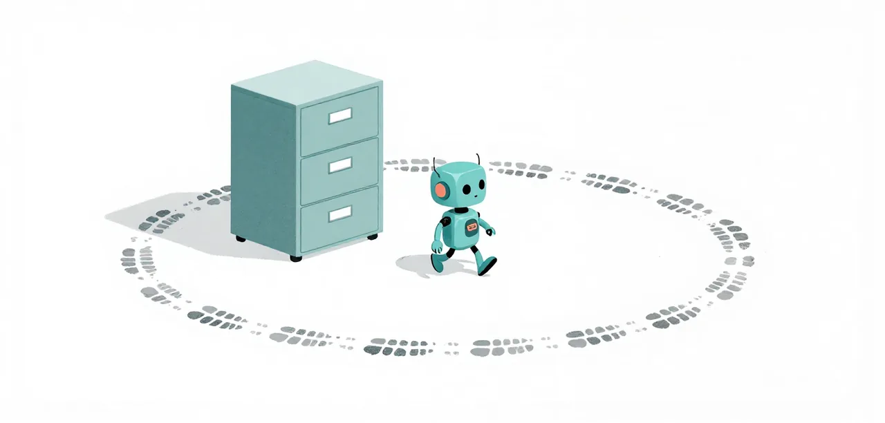

# E3 · Looking Around

The read and ls tools are how the model looks at a project, and a small model can
get stuck looking: the same call, again and again, with nothing changing. One
guard stops the repeat and tells it to act on what it already knows.

!!! abstract "Overview"

    **Questions**

    - What do `read` and `ls` give the model, and how does it misuse them?
    - What stops a model repeating the same call forever?

    **Objectives**

    - Recognise a repeat loop in a trace: one call, many times, nothing in between.
    - Add `guard/break-repeat-loops` and see the loop end.

{ .illustration }

## Problem

**Badge:** `screen`

The tools: `read` returns a file's contents, `ls` lists a folder. Both are
safe, so nothing stops the model calling them as often as it likes. A small
model sometimes loses its place and repeats one of them, unchanged, until the
session runs out of time. Nothing is wrong with the tool; the model is stuck.

## Eval case

**Badge:** `conjecture`

**Before:** Pi with what E1 and E2 added, `context/repair-think-tags` and
`context/trim-tool-output`.
**After:** the same plus `guard/break-repeat-loops`. Both run the lesson's own challenge,
`learn/challenges/looking-around/`: readings spread over 200 site files in
8 region folders. Find one sensor's reading, find a region's highest sensor,
then write a lookup module with tests. A session stuck repeating the same
look never reaches the later steps, and the hidden checks fail.

## Evidence of the problem

**Badge:** `screen`

A recorded ladder run made 245 identical `ls -R` calls, every one of them
successful, and never moved on. The loop was not seen in the nine bare
sessions of 2026-10-29 on the vLLM host; on this host it is rarer than the
foreground-server stalls (the pathologies page's "A server nobody can stop").

## Solution

**Badge:** `screen`

**Remedy unit:** `guard/break-repeat-loops`; apply it with `--remedy guard/break-repeat-loops`.

**Lesson check:** not built yet. A small challenge of this lesson's own,
failing without the remedy and passing with it, is planned; until
then the evidence below is the suites'.

The guard keeps the last 20 calls. The sixth identical call with nothing in
between is refused, with a reason the model can act on. An `edit`, `write` or
`bash` call clears the memory, because after one of those a repeated read may
legitimately return something new.

```ts
const key = callKey(call.toolName, call.input);
const seen = recent.filter((entry) => entry === key).length;
if (seen >= threshold) return { block: true, reason: "… Do not repeat it. Use what you already know." };
```

## Validation

**Badge:** `conjecture`

Not measured as a lesson yet. No arm has run, so there is no n to report. The guard was part of the guard set behind the
ladder's phase 2b (15 of 15), but on its own it has no before-and-after
record. This page says FAIL → PASS only once its challenge has shown it.

## Interpretation

The weakest badge is `conjecture`: the pathology is recorded, the fix is not
measured on its own. The guard is cheap and blocks nothing a working model
needs, which is why it ships in the worker; this lesson is where it has to
earn that.

### Run it yourself

Before, then after:

```bash
uv run python learn/code/harness.py run --suites-dir learn/challenges --suite looking-around --remedy context/repair-think-tags,context/trim-tool-output --repeat 1 --deadline 600 --stall 120
uv run python learn/code/harness.py run --suites-dir learn/challenges --suite looking-around --remedy context/repair-think-tags,context/trim-tool-output,guard/break-repeat-loops --repeat 1 --deadline 600 --stall 120
```

!!! success "Key points"

    - `read` and `ls` are safe, so a stuck model can repeat them until time runs out.
    - `guard/break-repeat-loops` refuses the sixth identical call and tells the model to act.
    - Edits, writes and commands reset it, so a real edit-and-check loop is never blocked.
