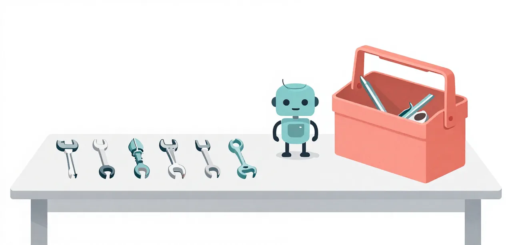

# E6 · Too Many Tools

Every installed extension can add tools, and a small model offered many reaches for ones it uses badly. One context unit offers it only the seven it needs, and with it the Easy tier is complete.

!!! abstract "Overview"

    **Questions**

    - Why does the number of tools offered matter to a small model?
    - Which tools does a coding task actually need?

    **Objectives**

    - Read the `tools` list in a request and count what the model was offered.
    - Add `context/narrow-tools` and see the request carry only the seven worker tools.

{ .illustration }

## Problem

**Badge:** `screen`

The tool list: each request tells the model which tools exist. Extensions such as subagents or todo lists add more. A small model offered a tool tends to try it, and spends turns on tools it cannot drive well instead of reading and editing.

## Eval case

**Badge:** `conjecture`

**Before:** bare Pi with what the earlier Easy lessons added
(`guard/break-repeat-loops, guard/stay-in-workspace, guard/refuse-whole-file-rewrite, guard/block-foreground-server`). **After:** the same plus `context/narrow-tools`. The
lesson's own challenge, a task built to provoke this failure, is not built
yet, so for now both run on Bronze.

## Evidence of the problem

**Badge:** `screen`

Part of the Baseline Worker since the first ladder runs, added because pi-subagents re-adds its own tools to every request. It has not been measured on its own.

## Solution

**Badge:** `screen`

**Remedy unit:** `context/narrow-tools`; apply it with `--remedy context/narrow-tools`.

**Lesson check:** not built yet. A small challenge of this lesson's own,
failing without the remedy and passing with it, is planned; until
then the evidence below is the suites'.

The unit rewrites each outgoing request: it keeps the seven worker tools and drops every other one, and drops a `tool_choice` that names a dropped tool. It is the same code the worker uses (`narrowTools`), so the two cannot drift.

```ts
const tools = payload.tools.filter((t) => WORKER_TOOLS.includes(t?.function?.name ?? t?.name));
if (tools.length) out.tools = tools; else delete out.tools;
```

## Validation

**Badge:** `conjecture`

Not measured as a lesson yet. No arm has run, so there is no n to report. This page says FAIL → PASS only once its
challenge has shown it.

## Interpretation

The weakest badge is `conjecture`: no record separates it on its own. On a bare Pi with no other extensions the list is already short, so its challenge has to install extra tools for the before state to show the failure. After this lesson the five Easy units together are `preset:easy`, the starting point of Medium.

### Run it yourself

Before, then after:

```bash
uv run python learn/code/harness.py run --suite easy --remedy guard/break-repeat-loops,guard/stay-in-workspace,guard/refuse-whole-file-rewrite,guard/block-foreground-server --repeat 3 --grade
uv run python learn/code/harness.py run --suite easy --remedy guard/break-repeat-loops,guard/stay-in-workspace,guard/refuse-whole-file-rewrite,guard/block-foreground-server,context/narrow-tools --repeat 3 --grade
```

!!! success "Key points"

    - Each tool offered is one more thing a small model may try and misuse.
    - `context/narrow-tools` keeps the seven worker tools and drops the rest.
    - This lesson completes `preset:easy`, where Medium starts.
