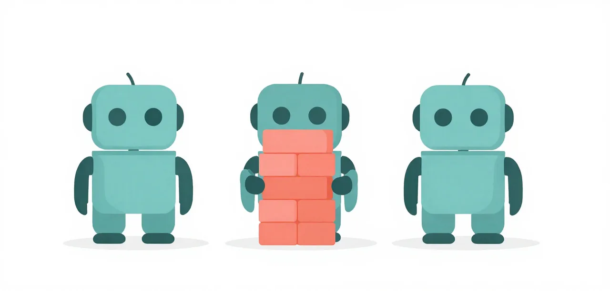

# H4 · Best of N

A phase that fails is retried one sample at a time, and one unlucky sample
per round can use up the whole budget. On a retry, the flow can run several
attempts in parallel at different temperatures and keep the first that passes
its gate.

!!! abstract "Overview"

    **Questions**

    - Why does a phase fail round after round when the model can do it?
    - What does a parallel retry buy, and what can it not fix?

    **Objectives**

    - Turn on parallel retries with `--retry-concurrency`.
    - Read which attempt won a round and how it became the workspace.
    - Tell a phase a new sample can rescue from one it cannot.

{ .illustration }

## Problem

**Badge:** `screen`

Each round of a phase is one sample from the model. When a phase needs a
retry, the next round is one more sample, after the last one, from wherever
the last one left the workspace. A run that spends six rounds on a phase pays
for six serial attempts.

## Eval case

**Badge:** `conjecture`

**Before:** `flow_run.py` with its defaults, one attempt per round
(`--retry-concurrency` follows `--concurrency`, which is 1). **After:**
`--retry-concurrency 3`: the first round of a phase is still one attempt, and
every retry round runs three. This is the last piece of the Hard tier, so its
after state, written as one line, is `preset:hard`: every tool and remedy the
course teaches. That is where [The Challenge](../../challenge/index.md)
starts.

## Evidence of the problem

**Badge:** `screen`

Both 2026-10-29 forced runs used one attempt per round. In the first, Silver's
phase 4 passed in round 6 and Gold's phase 7 failed all six rounds on a
migration that stayed invalid SQL. In the rerun, Gold's phase 5 failed six
rounds on a gate that contradicts itself (four state changes, then an
assertion of three audit entries). No sample can pass that gate.

## Solution

**Badge:** `conjecture`

**Remedy unit:** none: parallel attempts are `--retry-concurrency` in `learn/code/flow_run.py`, not a unit.

**Lesson check:** not built yet. A small challenge of this lesson's own,
failing without the remedy and passing with it, is planned; until
then the evidence below is the suites'.

On a retry round with `--retry-concurrency N`, the harness:

1. forks the workspace N times (the virtual environment is shared, read-only);
2. runs the driver in each fork at its own temperature, spread from 0.3 to
   1.2 (three attempts: 0.3, 0.75 and 1.2);
3. scores each fork on this phase's frozen gate, and promotes the first fork
   that passes to be the workspace, then checkpoints it.

The first round stays a single attempt, so phases that pass first time cost
nothing extra. The server must batch concurrent requests for this to save
time; parallel attempts do not make one attempt faster.

## Validation

**Badge:** `conjecture`

Not measured as a lesson yet. No arm has run, so there is no n to report. No 2026-10-29 run used parallel attempts, so
there is no before-and-after on this host. What the runs do show is the limit:
Gold's phase 5 failed on a broken gate, and three samples against a gate no
build can pass are three failures.

## Interpretation

The weakest badge is `conjecture`. Best of N trades compute for variance on
the phases that retry; it cannot rescue a phase whose gate is wrong or a
mistake every sample shares. Finished Hard? Start
[The Challenge](../../challenge/index.md) from `--remedy preset:hard`. The
course gives every tool there is, not a guaranteed pass: whether you pass Gold
is what The Challenge measures.

### Run it yourself

Before, then after, on Gold:

```bash
uv run python learn/code/flow_run.py --suite hard
uv run python learn/code/flow_run.py --suite hard --retry-concurrency 3
```

!!! success "Key points"

    - `--retry-concurrency N` runs N parallel attempts on retry rounds only, at temperatures from 0.3 to 1.2.
    - The first fork that passes the phase's frozen gate becomes the workspace and is checkpointed.
    - More samples cannot fix a broken gate; the Hard tier ends at `preset:hard`, where The Challenge starts.
