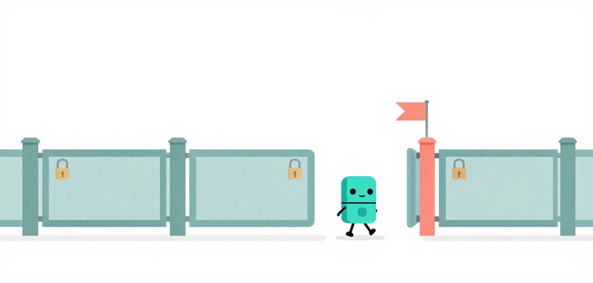

# H2 · Frozen Gates and Checkpoints

A phase's acceptance test is worth something only if nobody can quietly change
it, and a passing phase only if a later one cannot break it. The flow freezes
each phase's gate and commits each passing phase, so a broken round is reverted.

!!! abstract "Overview"

    **Questions**

    - What stops a later phase breaking an earlier one?
    - How can a harness that guards the gate still let a wrong build through?

    **Objectives**

    - Find a run's frozen gates and its checkpoint commits.
    - Name the three gate faults the 2026-10-29 run found and how each was fixed.
    - Tell the suite's hidden grade (the oracle) from a phase's gate (a proxy).

{ .illustration }

## Problem

**Badge:** `screen`

Silver's phase 4 builds on phases 1 to 3. If the coder can edit the test it
is judged by, it can make the test easier instead of the code right; if a
round leaves `app.py` uncompilable, every later phase and the final grade
inherit the rubble.

## Eval case

**Badge:** `conjecture`

**Before:** a phase test the coder can change, and a broken round carried
forward. **After:** each phase's gate frozen under `plan/gate/`, and the
workspace committed after every passing phase. Neither piece can be switched
off on its own in `flow_run.py` today, so this lesson has no before to run:
both runs below have them, and the evidence is how they failed and were
fixed.

## Evidence of the problem

**Badge:** `screen`

The first forced run (2026-10-28/29, n = 1: Bronze 4/4, Silver 13/18, Gold
30/34) found three gate faults, each reproduced by re-running the gate by
hand:

1. **A gate that cannot pass.** Bronze's gate called `inspect.getfile` on the
   app, which raises for every app; Silver's phase 4 gate asserted a 303
   through a client that follows redirects, and the app answered 303 as the
   spec says.
2. **A revert deleted the frozen gate.** A round left `app.py` uncompilable;
   the revert to the phase 3 checkpoint removed the phase 4 gate, frozen after
   it.
3. **A re-frozen gate dropped the requirement.** The new phase 4 gate checked
   only that the board loads and posting redirects. The phase passed with no
   resolve or reopen code, and the hidden grader missed all five phase 4
   checks.

## Solution

**Badge:** `screen`

**Remedy unit:** none: frozen per-phase gates and the checkpoint revert are built into `learn/code/flow_run.py` and cannot be switched off on their own.

**Lesson check:** not built yet. A small challenge of this lesson's own,
failing without the remedy and passing with it, is planned; until
then the evidence below is the suites'.

- **Frozen:** before the gate runs, the harness copies every frozen
  `plan/gate/phase_N.py` back into `tests/`, undoing any edit the coder made.
- **Per phase:** a phase is scored on its own gate, so a brittle earlier gate
  cannot fail a later phase.
- **Checkpoint:** the workspace is a git repository; each passing phase is a
  commit, and a round that leaves the app uncompilable is reverted to the
  last one.
- **The fixes:** frozen gates now survive a revert, so a phase's gate is never
  replaced by a weaker one; and every gate's client is forced not to follow
  redirects.

## Validation

**Badge:** `screen`

The rerun with the fixes (n = 1) gave Bronze 4/4, Silver 18/18 and Gold
30/34. Every Bronze and Silver phase passed its gate in round 1 with no
revert, so Silver's 18/18 is **not** attributable to the revert fix. Gold
showed it working live: in phase 7 a round left the app uncompilable, the
harness reverted to the phase 6 checkpoint, and the phase 7 gate survived.

One fault remains. Gold's phase 5 gate failed six rounds on a
self-contradicting test (four state changes, then an assertion of three audit
entries). It raises no exception, so the planned dry run for broken gates
would not catch it.

## Interpretation

The weakest badge is `screen`: one run per level, before and after the fixes.
What held up is the method: the suite's hidden grader is the oracle and the
gate is a proxy, so a gate can false-fail a correct build or pass a wrong one.
The fixes are harness guarantees, agnostic of any suite, rather than another
sentence in a prompt.

### Run it yourself

Run Silver, then read the run's gates and checkpoints. `flow_run.py` prints
the run directory at the end as `bundle=…`.

```bash
uv run python learn/code/flow_run.py --suite medium
BUNDLE=/path/printed/as/bundle
ls "$BUNDLE/workspace/plan/gate"
git -C "$BUNDLE/workspace" log --oneline
```

!!! success "Key points"

    - Each phase's gate is frozen and restored before it runs, so the coder cannot weaken it.
    - Each passing phase is a commit; a round that breaks the app is reverted, and frozen gates survive the revert.
    - A gate is a proxy for the hidden grade: one run's re-frozen gate passed a build missing five checks.
