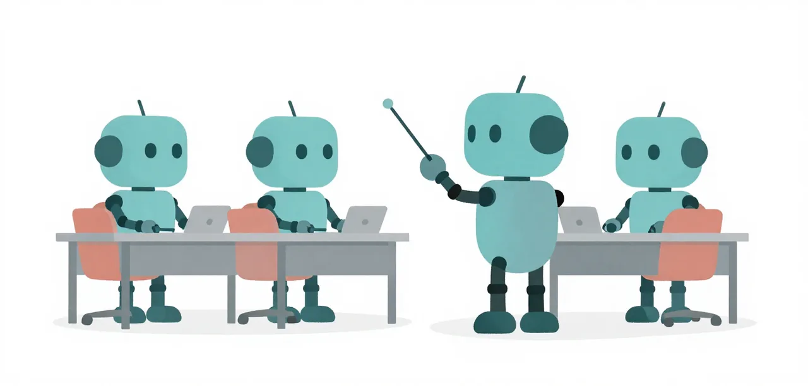

# Hard Lessons

The orchestration paradigm: who drives the model, how work is split into
roles, checked and re-dispatched. You start with every Medium unit on. H1 to
H4 each add one flow switch; H5 and H6 teach you to build your own tool and
remedy, and in each your own file is what gets the pass. After H6 you have
everything [The Challenge](../../challenge/index.md) needs.

{ .illustration }

## Who drives

When the model is the primary agent, it owns the plan, the tool list and the
word "finished". Nothing outside it knows what done meant, so a missed phase,
a narrowed test or a hung server comes back as a confident final over work it
never checked. Every Hard lesson moves one of those decisions out of the
model's text and into a driver above it: the flow that plans and checks each
phase, the checkpoint that reverts a breaking change, the frozen test that
defines done, the extra attempts that pick a passing one. The model stays the
same; what changes is who decides. On 2026-10-25 the two arms (the model
driving, a worker above it) passed the same on Bronze and Silver, but failed
differently: the model-driven sessions hung on foreground servers and wrote
outside the layout, and the worker's did neither
([evidence](https://github.com/andrevanzuydam/mellum-worker/blob/main/docs/superpowers/research/2026-10-29-lessons-left-the-track.md)).

## The lessons

-   **[H1 · Plan, Examine, Code](plan-examine-code.md)**

    ---

    The flow's roles as tools the agent calls.
    Adds `workflow/spec-driven-flow`.

-   **[H2 · Frozen Gates and Checkpoints](frozen-gates-and-checkpoints.md)**

    ---

    Per-phase gates the coder cannot weaken, and a revert to the last good phase.

-   **[H3 · Don't Trust the Self-Exit](dont-trust-the-self-exit.md)**

    ---

    An external acceptance test decides when the work is done.

-   **[H4 · Best of N](best-of-n.md)**

    ---

    Parallel attempts on retry, keeping the one that passes. Completes `preset:hard`.

-   **[H5 · Build a Tool](build-a-tool.md)**

    ---

    Write an extension that gives the model a new capability. Your tool gets the pass.

-   **[H6 · Build a Remedy](build-a-remedy.md)**

    ---

    Write a remedy unit for a failure no unit fixes. Your remedy gets the pass.

