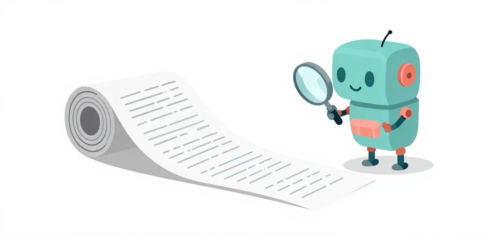

# M7 · Keep a Plan

A long task of many small parts is easy to lose track of part-way through. One tool gives the model a plan file it writes, follows and amends.

!!! abstract "Overview"

    **Questions**

    - What does a small model drop when a task has many separate parts?
    - How does a written plan keep a long session on track?

    **Objectives**

    - Run a many-part task and see which parts a session leaves out.
    - Add `tool/keep-a-plan` and see the session work through its own TODO.md.

{ .illustration }

## Problem

**Badge:** `conjecture`

A task with many small, separately checked parts asks the model to remember all of them. Part-way through, a small model loses track and finishes with parts never started.

## Eval case

**Badge:** `conjecture`

Not built yet. This lesson's own challenge, `learn/challenges/keep-a-plan/`, is
planned under the uniform-lessons plan; its before and after lines arrive
with it.

## Evidence of the problem

**Badge:** `conjecture`

None yet: no arm has run on this lesson's challenge, so there is no n to
report.

## Solution

**Badge:** `conjecture`

**Remedy unit:** `tool/keep-a-plan`; apply it with `--remedy tool/keep-a-plan`.

**Lesson check:** not built yet.

## Validation

**Badge:** `conjecture`

Not run. The lesson check will run the before and after lines on the 6-bit
reference model and record the result here.

## Interpretation

The weakest badge is `conjecture`: this page names a failure and its remedy,
and nothing has been measured yet. Read it as the plan for a lesson, not as a
lesson.

### Run it yourself

The before line, until the challenge and its after line exist:

```bash
uv run python learn/code/harness.py run --suites-dir learn/challenges --suite keep-a-plan --remedy guard/break-repeat-loops,guard/stay-in-workspace,guard/refuse-whole-file-rewrite,guard/block-foreground-server,context/narrow-tools,context/add-project-facts,context/use-short-prompt,nudge/nudge-empty-turn,tool/background-long-commands,tool/lookup-library-docs,check/check-code-quality --repeat 1
```

!!! success "Key points"

    - A long task loses parts when nothing holds the list.
    - `tool/keep-a-plan` keeps a TODO.md the model writes, follows and amends.
    - This lesson's challenge and check are not built yet.
