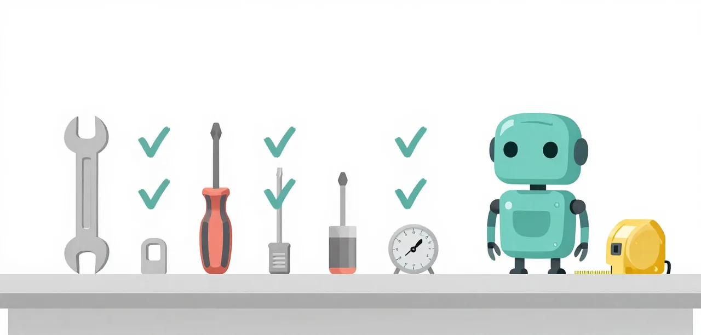

# Toolchain and Checks

Everything here runs from a clone, and every Python command is `uv run` from
the repository root.

{ .illustration }

## Python, uv and `pyproject.toml`

The root `pyproject.toml` pins `requires-python = ">=3.14"` and declares
`[tool.uv] package = false`, so `uv run` fetches an interpreter when the
machine has none, then runs the command in a throwaway project environment.
`uvx` follows the same idea for tools: nothing is installed globally.

`[tool.mellum]` in that file is the single source of model settings:
`model`, `context`, `max_tokens`, `temperature`, `top_p`, `top_k`. Do not
edit sampling anywhere else: `learn/code/profile/models.json` is generated
from it, and `tests/backend-profile.test.mjs` fails when the two disagree.

## The local backend

`scripts/backend.py` is stdlib only and reads `[tool.mellum]` with `tomllib`:

| Command | Does |
| --- | --- |
| `uv run scripts/backend.py serve` | `llama-server` in the foreground |
| `uv run scripts/backend.py start` | background, pidfile and log, waits for health |
| `uv run scripts/backend.py status` | `up`/`down` on `127.0.0.1:8002`, with `n_ctx` |
| `uv run scripts/backend.py stop` | stops the background server |
| `uv run scripts/backend.py chat "…"` | one request with the settings as parameters |
| `uv run scripts/backend.py profile` | rewrites the private Pi profile |

The profile lives at `learn/code/profile/`. Lessons point Pi at it with
`PI_CODING_AGENT_DIR` and `--no-extensions --no-skills --no-context-files
--no-approve`, so a learner's own `~/.pi` is neither read nor written.

## The lesson harness

`uv run learn/code/harness.py run --suite easy` (Bronze) copies the task into
`learn/code/.runs/<id>/workspace`, starts a child `pi` with the private
profile and the recorder in `learn/code/record-pi.mjs`, sends every prompt in
`prompts/` (or `task.md`) in one session, then copies the task's tests in and
scores once. `--repeat N` repeats the session and every line states n. Runs are kept, including failures, and `--dry-run`
prints the child's argv. The harness's own tests run under `uvx pytest` from
`tests/harness.test.mjs`.

`run --suite all` runs every suite and totals the passes; `--grade` adds
`uvx ruff check`, `uvx pyrefly check` (with a generated `pyrefly.toml`) and
`uvx complexipy --max-complexity-allowed 10` on the model's files, before the
tests are copied in. A grader's failure never changes a task's score.

## Checks

```bash
npm test                      # the Node suite, including the ladder's recorder tests
uv run pytest                 # from ladder/, the ladder's own tests
node build.mjs                # regenerate the agent templates
uv run zensical build         # build the Learning Center into site/
uv run zensical serve         # live preview, rebuilding on change
```

Zensical and the glossary extension are `dev` dependencies in
`pyproject.toml`, so `uv sync` puts them in the project virtualenv and
`uv run` uses them. Installing them there rather than supplying them per
command is what makes the extension importable by `zensical serve`'s reload
worker; the same `uv run zensical build` runs in CI.

`npm test` includes tests that spawn `uv run scripts/backend.py`, so `uv` is
a development prerequisite even though most of the suite is Node.

## Records and release

Measured work lands in `docs/superpowers/research/` with its preregistration;
raw evidence goes to a `research-*` release, never into Git. A release is a tag that
matches `package.json` and both README install lines, with a
[`CHANGELOG.md`](https://github.com/andrevanzuydam/mellum-worker/blob/main/CHANGELOG.md)
section; `[Unreleased]` is kept current as work lands.
